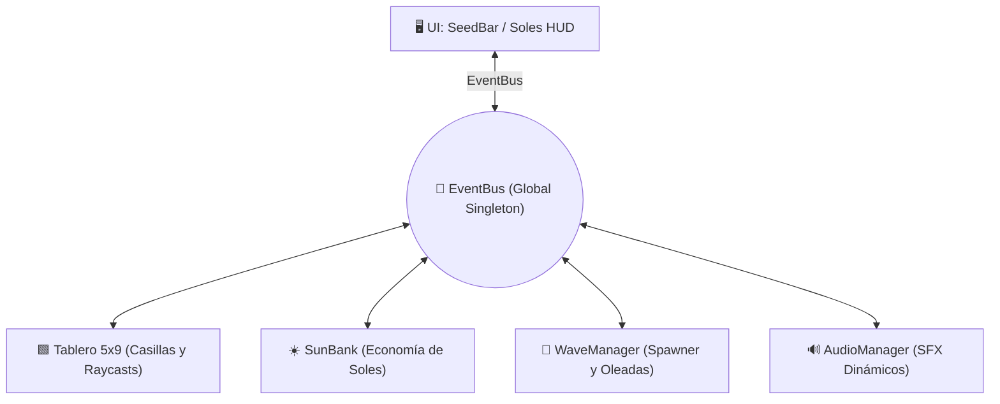

# 🌻 Plantas vs Zombies (Temu Edition) — Godot 4.6

[](https://godotengine.org)
[](https://microsoft.com/windows)
[](LICENSE)
[](https://github.com/cesaralejandromartesbonilla-a11y/plantas-vs-zombie-vtemmu)

Recreación fiel, modular y de alto rendimiento de las mecánicas esenciales de *Plants vs. Zombies* en **Godot 4.6 (Forward Plus)**. Construido con una arquitectura desacoplada basada en bus de eventos (`EventBus`), economía reactiva de soles, catálogo dinámico de plantas mediante `PlantLibrary` y un generador inteligente de oleadas de zombis.

---

## 🎯 Arquitectura de Comunicación (Event-Driven)



---

## 🚀 Cómo Ejecutar el Proyecto

1. **Requisitos:** Godot Engine 4.4 o 4.6 con renderizador Forward Plus.
2. **Escena Principal (`F5`):**
   - [`res://scenes/main/main.tscn`](file:///c:/Users/cesar/Desktop/games/backup/GodotProjects/01_Prototypes/plantas-vs-zombie-vtemmu/scenes/main/main.tscn) — Nivel completo jugable con jardín de 5 carriles, barra de semillas, caída de soles y oleadas de zombis.

---

## 🌟 Características y Mecánicas Implementadas

### 1. Tablero por Rejilla (Grid-Based Board)
- **Matriz de 5x9 casillas (`board.tscn` & `cell.tscn`):** Detección de casillas ocupadas/libres, previsualización de colocación de planta y validación de coste de soles.
- **Detección por carril:** Raycasts horizontales en cada planta ofensiva para detectar presencia de zombis antes de abrir fuego.

### 2. Catálogo de Plantas Disponibles (`scenes/plants/`)

| Planta | Coste Soles | Función |
| :--- | :---: | :--- |
| **Girasol (`sunflower.tscn`)** | 50 ☀️ | Genera soles periódicamente cada 10-15 segundos. |
| **Lanzaguisantes (`peashooter.tscn`)** | 100 ☀️ | Dispara guisantes directos al detectar zombis en su carril. |
| **Repetidora (`repeater.tscn`)** | 200 ☀️ | Dispara ráfagas dobles consecutivas de guisantes. |
| **Lanzaescarcha (`snowpea.tscn`)** | 175 ☀️ | Dispara guisantes helados que ralentizan la velocidad del zombi. |
| **Nuez (`wallnut.tscn`)** | 50 ☀️ | Alta resistencia física con 3 fases de daño visible. |
| **Petacereza (`cherrybomb.tscn`)** | 150 ☀️ | Detonación inmediata en área de $3 \times 3$ casillas. |

### 3. Horda de Zombis y Oleadas (`WaveManager.gd`)
- **Comportamiento modular de zombis (`zombie.tscn`):**
  - Estado de patrulla / caminata lineal por carril.
  - Estado de alimentación: detención y mordisco con daño periódico a la planta interceptada.
  - Estado de muerte e impacto crítico por proyectiles.
- **Sistema de Oleadas:** Progresión de dificultad con pausas tácticas y oleadas masivas finales.

### 4. Economía Reactiva (`SunBank.gd`)
- Caída procedural de soles desde el cielo en intervalos configurables.
- Animación de rebote y desvanecimiento temporal si no son recogidos.
- Recolección por clic/toque con interpolación suave (`Tween`) hacia el contador del HUD.

---

## 🕹️ Mapeo de Controles

| Acción | Control | Función |
| :--- | :---: | :--- |
| **Seleccionar Semilla** | `Clic Izquierdo` en tarjeta | Elige la planta a cultivar si hay suficiente sol |
| **Colocar Planta** | `Clic Izquierdo` en casilla | Planta la semilla en la celda seleccionada |
| **Cancelar Selección** | `Clic Derecho` / `Esc` | Cancela la colocación de la planta |
| **Recolectar Sol** | `Clic Izquierdo` sobre sol | Recoge el sol y suma 25 puntos a la cuenta |
| **Pausar Partida** | `Esc` / Botón Pausa | Despliega el menú de pausa |

---

## 📁 Estructura del Proyecto

```
plantas-vs-zombie-vtemmu/
├── autoload/                  # EventBus, GameManager, SunBank, PlantLibrary, WaveManager, AudioManager
├── data/
│   ├── plant_data/            # Recursos .tres de estadísticas por planta (sunflower, peashooter, wallnut)
│   └── plant_data.gd          # Clase base de recurso PlantData
├── scenes/
│   ├── main/                  # main.tscn (Escena principal de nivel)
│   ├── board/                 # board.tscn, cell.tscn (Rejilla del jardín)
│   ├── plants/                # sunflower, peashooter, repeater, snowpea, wallnut, cherrybomb
│   ├── projectiles/           # pea.tscn, snowpea_projectile.tscn
│   ├── zombies/               # zombie.tscn
│   └── sun/                   # sun.tscn, sun_spawner.gd
├── ui/                        # hud.tscn, seed_bar.tscn, seed_slot.tscn, victory_screen, defeat_screen
├── docs/                      # Hoja de ruta técnica de MVP
└── project.godot              # Configuración de motor Godot 4.6
```

---

## 📄 Licencia

Código propio bajo licencia MIT. Godot Engine bajo licencia MIT.
